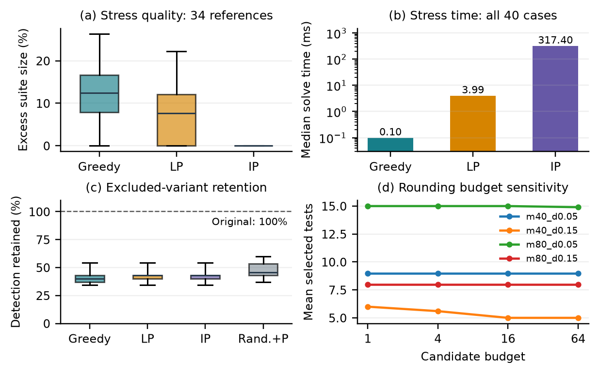

# RV32 Test Suite Minimization

Experiment code and archived data for **Minimizing Tests for RV32 Instruction
Semantics: Greedy, LP Rounding, and Integer Programming**.

Regression tests can expose the same faults repeatedly. This project selects a
small subset of tests while preserving detection of every target variant detected
by the original suite. It compares greedy selection, LP relaxation with randomized
rounding and repair, and integer programming on the same unit-cost set-cover
problem. All experiments run locally on a CPU.

## Scope and methods

The instruction-result models cover RV32I `ADD`, `SUB`, `AND`, `XOR`, `SLL`, `SRL`,
`SRA`, `SLT`, and `SLTU`, plus `MUL` from the M extension. Each test consists of an
operation and two operand bit patterns. The benchmark contains 65 seeded faulty
variants. The 8-bit and 16-bit models are scaled-width sensitivity experiments.

For detection matrix `A`, binary variable `x[j]` selects test `j`:

```text
minimize    sum_j x[j]
subject to  sum_j A[i,j] x[j] >= 1  for every originally detectable target i
            x[j] in {0, 1}
```

Common preprocessing removes zero columns and merges identical detection columns.
The methods then use the same feasible set and objective:

| Method | Implementation |
| --- | --- |
| Greedy | Maximum uncovered-target gain, followed by reverse deletion. |
| LP rounding | SciPy/HiGHS interior-point LP, up to 16 rounding candidates, greedy repair, and reverse deletion. |
| Integer programming | SciPy/HiGHS branch-and-cut, zero target MIP gap, and a five-second limit per run. |
| Random baseline | Random candidate order until all targets are detected. |

The final comparison also includes **Random+P**, a retrospective control that
applies the same reverse-deletion rule to the archived random suites. Its quality
results are in `supplement/analysis/audit_random_pruned.csv`; its additional
pruning time was not measured. The primary `results/` files retain the original
random baseline.

## Installation

The recorded environment used Python 3.12.14, NumPy 2.3.5, SciPy 1.18.1, and
Matplotlib 3.11.2 on macOS arm64. Python 3.12 is recommended for the pinned
dependencies. Linux and Windows users can use the same Python entry points.

```bash
git clone https://github.com/jzhchu/rv32-test-suite-minimization.git
cd rv32-test-suite-minimization
python3.12 -m venv .venv
source .venv/bin/activate
python -m pip install -r requirements.txt
```

On Windows, activate the environment with `.venv\Scripts\Activate.ps1` in
PowerShell and run the Python commands below.

## Reproduce the experiments

### Check the archived results

```bash
python -m unittest discover -s tests -v
python -m atm.verify_results
```

The checks exhaust all 65,536 8-bit input pairs for addition, subtraction, and
multiplication against independent bitwise oracles, check semantic boundaries,
and compare IP with exhaustive enumeration on 30 small covering instances.
The result auditor reconstructs 70 arithmetic matrices and validates all 1,320
archived selected suites on their original matrices. It also checks the matching
primal and global objective bounds for the 312 IP runs reported as optimal.

### Run a small smoke experiment

```bash
bash run_local.command --quick --output results_quick
```

The quick configuration uses six instances and one timing repetition. On Windows:

```bash
python -m atm.experiment --quick --output results_quick
python -m atm.reporting --output results_quick
python -m atm.verify_results --output results_quick
```

### Run the full primary grid

```bash
bash run_local.command --output results_reproduced
```

The shell runner executes the correctness checks, primary experiment, result
summarization, and independent auditor. The corresponding Python entry points are:

```bash
python -m atm.experiment --output results_reproduced
python -m atm.reporting --output results_reproduced
python -m atm.verify_results --output results_reproduced
```

The full run took about three minutes in the recorded environment. Fresh output
directories preserve the archived data. Omitting `--output` uses `results/` and
overwrites generated results there. Timings and time-limited MIP incumbents can
vary with the machine and load; the recorded results remain in this repository.

### Reproduce the supplementary analysis and paper figures

Using the archived primary data:

```bash
python supplement/audit_analysis.py
python supplement/additional_analysis.py --reuse-ablation
```

The first command recomputes the fair pruning control, excluded-variant detection,
and LP primal/dual checks. The second reuses the archived 280-call ablation to
regenerate the figures and summaries.

To rerun the ablation and analyze a fresh **full-grid** primary experiment:

```bash
python supplement/audit_analysis.py \
  --results results_reproduced --output supplement_reproduced
python supplement/additional_analysis.py \
  --results results_reproduced --output supplement_reproduced
```

The supplementary scripts require the full instance grid. Omitting
`--reuse-ablation` performs all 280 rounding calls again and records new times.

## Experiment design and archived findings

| Family | Design | Instances |
| --- | --- | ---: |
| RV32 semantics | Candidate sizes 300/1,200/4,800; added boundary ratios 0.2/0.8; 30/65 variants; five data seeds | 60 |
| Scaled-width sensitivity | Widths 8/16; 1,200 candidates; 65 variants; five data seeds | 10 |
| Synthetic structure | 40/80 rows; 160/640 columns; Bernoulli densities 0.05/0.15; five data seeds | 40 |

Each of four methods runs three times per instance: 110 x 4 x 3 = **1,320 primary
runs**. The same five data seeds are reused across configurations. The
supplementary budget study uses seven fixed matrices, four budgets, and ten
rounding seeds: **280 calls**, rather than 280 independent datasets.

In the archived RV32 results, greedy matches 58 of 60 proved optima; LP rounding
and IP match all 60. On the 34 synthetic instances with proved optima, greedy and
LP rounding have median size gaps of 12.50% and 7.69%. Six synthetic IP instances
remain unproved after the time limit; their bounds and incumbents are preserved.
The excluded-variant study shows that preserving the specified detection targets
can still lose other detections.



## Files

```text
atm/benchmark.py             Instruction semantics, variants, test generation
atm/solvers.py               Greedy, LP rounding/repair, IP, and random selection
atm/experiment.py            Grid, seeds, timing, and run-level evidence
atm/reporting.py             CSV summaries and primary visualizations
atm/verify_results.py        Independent matrix and result auditor
tests/test_core.py           Semantic and optimization correctness checks
config.json                 Frozen primary configuration
requirements.txt            Pinned numerical dependencies
results/                    Archived inputs, selections, runs, and manifests
supplement/audit_analysis.py Fair control, excluded variants, and LP witnesses
supplement/additional_analysis.py  Rounding ablation and paper figures
supplement/analysis/         Archived supplementary numeric evidence
supplement/figures/          Vector PDF and PNG figures used by the report
artifact_sha256.json        SHA-256 manifest for the published artifact
```

Primary evidence includes `raw_runs.csv`, `summary.csv`, `solutions.json`,
`instances.csv`, `manifest.json`, and the input JSON/NPZ files under `instances/`.
The manifest records the original core-source hashes and environment. The core
experiment source and recorded numeric data are preserved in this public artifact.

## Interpretation and limitations

- The benchmark evaluates instruction result functions. Processor decoding,
  register-file behavior, control flow, and memory are outside its scope.
- Seeded variants are artificial faults; synthetic incidence matrices are a
  separate structural experiment. Neither is a large-scale real-world dataset.
- Detection preservation applies to the specified, originally detectable targets.
  The excluded variants are correlated members of the same catalog.
- Selection minimizes test count. Replay-cost and break-even measurements use the
  documented in-process Python models.
- Greedy, rounding, repair, deletion, generation, and validation are implemented
  here. The LP and MIP optimization engines are provided by SciPy/HiGHS.

## References

- [RISC-V ISA manual, version 20240411](https://docs.riscv.org/reference/isa/v20240411/_attachments/riscv-unprivileged.pdf).
- Chvatal (1979), [A Greedy Heuristic for the Set-Covering Problem](https://doi.org/10.1287/moor.4.3.233).
- Raghavan and Thompson (1987), [Randomized Rounding](https://doi.org/10.1007/BF02579324).
- [SciPy `linprog`](https://docs.scipy.org/doc/scipy/reference/generated/scipy.optimize.linprog.html),
  [SciPy `milp`](https://docs.scipy.org/doc/scipy/reference/generated/scipy.optimize.milp.html),
  and [HiGHS](https://highs.dev/).
